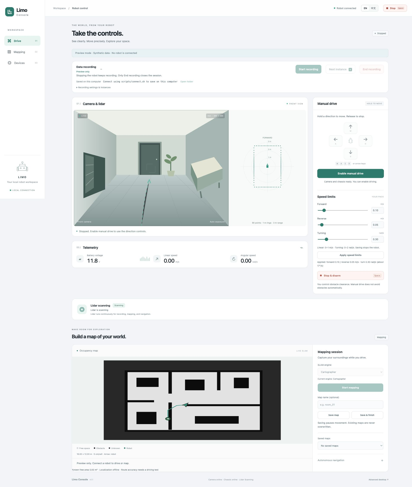

# Limo Console

**Drive, map and record an AgileX LIMO from a bilingual local workspace.**

English · [简体中文](README.zh-CN.md)

Camera and lidar share one view. Set your forward, reverse and turning limits, map manually or use checked Nav2 goals, and keep synchronized recordings on your computer. The interface has no cloud service, CDN or frontend build step.



## Recording belongs to the operator

- **Start recording** opens a session. Connecting or refreshing the browser does not start one.
- **Next instance / N** divides the current session into routes or tasks without stopping driving.
- **End recording** closes the session and completes archival. It also disarms driving.
- **Stop / Space** stops the robot. Recording continues through stops, obstacle pauses and planning waits.
- A recording fault disarms driving and marks the incident. Available streams continue recording; faults do not masquerade as a user-completed session. Enabling driving requires a healthy recording session.

Images and videos are saved only on the computer. The robot keeps a bounded RAM image transport and a bounded non-image MCAP spool. Sensor chunks are deleted from the robot only after the computer checks their SHA-256 and size and durably saves both file and receipt.

## Features

- Hold-to-drive keyboard/touch controls; independent forward/reverse limits **0–1 m/s**, turning **0–2 rad/s**. Saving limits stops and disarms.
- Native-aspect camera alongside lidar, battery, measured speed and status. English / 简体中文 throughout.
- Default **640 × 480, 10 fps H.264 MP4**; selectable native camera resolutions, **FFV1 MKV** or **PNG sequences** for lossless RGB storage. Unsupported throughput locks driving; advertised camera capabilities are not performance guarantees.
- Raw non-image ROS topics, odometry, IMU, requested and applied controls, chassis state, configuration and operator events in MCAP. Offline CSV export and non-destructive recovery tools.
- Manual SLAM, map export, SLAM checkpoints and saved-map localization with an explicit starting pose. Bounded frontier exploration uses Nav2 path checks and stops when progress cannot be verified.
- A capability harness with observations, bounded operations, outcome checks and offline replay. Motion is disabled in the harness by default. No language model or cloud credential is required.
- Lidar continuously scans. There is no pause/resume or motor-stop control.

## Quick start

Requires a working ROS 2 Humble robot environment. See [installation](docs/installation.md) before first use.

```sh
git clone https://github.com/EZeJ/limo-console.git
cd limo-console
# On the robot, inside its ROS environment:
sudo bash scripts/install.sh
bash /control/manage.sh start
# On your computer (Python 3.10+):
./scripts/connect.sh USER@ROBOT_HOST
```

Open **http://127.0.0.1:18765/**. Click **Start recording**, wait for readiness, then explicitly enable driving. The SSH helper asks for your own credentials; it stores no password. Recordings default to `~/Documents/Limo Console/recordings/`; choose another directory with `--data-dir PATH`.

For a read-only synthetic preview without a robot:

```sh
python3 -m venv .venv
. .venv/bin/activate
python -m pip install -r requirements-dev.txt
python scripts/preview.py
```

Open **http://127.0.0.1:18766/**. Its camera scene and map are synthetic; no robot connection or movement is possible.

## Documentation

| Topic | English | 简体中文 |
| --- | --- | --- |
| Install, deploy, driver patch, rollback | [Installation](docs/installation.md) | [安装与部署](docs/installation.zh-CN.md) |
| Driving, recording, mapping, recovery | [User guide](docs/usage.md) | [使用指南](docs/usage.zh-CN.md) |
| Data format, API, control model | [Architecture](docs/architecture.md) | [架构与 API](docs/architecture.zh-CN.md) |
| Harness and acceptance criteria | [Harness](docs/harness.md) | [Harness 与验收](docs/harness.zh-CN.md) |
| Contributing | [Development](CONTRIBUTING.md) | [开发说明](CONTRIBUTING.zh-CN.md) |

## Scope and validation

```text
robot/          Robot services, launch/configuration and bilingual web UI
robot/integration/  Focused driver patch, source verification and provenance
companion/      Computer gateway, video recording, verified archival
harness/        Capabilities, stationary diagnostics, offline export/recovery
scripts/        Connect, deploy, install, rollback and synthetic preview
tests/          Synthetic, hardware-free regression tests
docs/           English/Chinese guides and synthetic screenshots
```

The target is ROS 2 Humble on Ubuntu 22.04 / ARM64 Jetson with the vendor LIMO workspace installed separately. This is an independent project, not an official AgileX product. The repository contains only console code and integration material: no private recordings, household maps, credentials, firmware or full vendor workspace.

The services bind to loopback and rely on SSH access. Manual driving relies on operator clearance judgment. The chassis driver needs its own watchdog. Software tests and a fresh map do not certify motion accuracy: [acceptance criteria](docs/harness.md) explicitly separate static checks from route and exploration tests, which require a charged robot and a suitable area.

## License

Original console code: [GNU GPL v3.0 (GPL-3.0-only)](LICENSE). Adapted upstream configuration and driver-patch context retain the licenses listed in [third-party notices](THIRD_PARTY_NOTICES.md).
