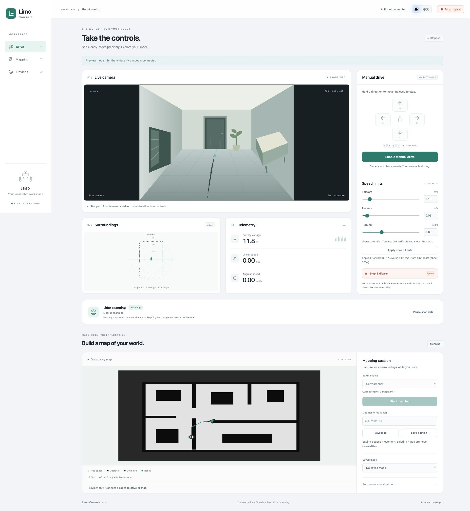

# Limo Console

**A focused, bilingual control workspace for the AgileX LIMO robot.**

English · [简体中文](README.zh-CN.md)

See the camera, steer with a keyboard or touch controls, set your own speed limits, and build a map as you drive. Limo Console runs beside a ROS 2 robot stack and is reached through an SSH tunnel. It has no cloud service and no frontend build step.



## What it does

- **Manual driving:** hold-to-move controls, W/A/S/D or arrow keys, a persistent stop button, and configurable forward, reverse, and turning limits.
- **Live observation:** front-camera frames, lidar top view, battery voltage, and measured linear/angular speed.
- **Mapping:** start SLAM without autonomous movement, save named maps, finish with a save, and download portable PGM + YAML ZIPs.
- **Lidar data control:** pause/resume scans with state verification and persistent settings. Pausing data does **not** guarantee that the lidar motor stops.
- **Optional navigation:** explicit opt-in map goals, bounded exploration, and return along a recorded route through Nav2.
- **English and Simplified Chinese:** switch at any time; preference is stored only in your browser. Status messages, validation, and accessible labels are translated.

## Try the interface without a robot

Python 3.10+ is recommended. From a fresh clone:

```sh
git clone https://github.com/EZeJ/limo-console.git
cd limo-console
python3 -m venv .venv
. .venv/bin/activate
python -m pip install -r requirements-dev.txt
python scripts/preview.py
```

Open **http://127.0.0.1:18766/**. The preview uses a drawn camera scene and a generated map. It does not import ROS, contact a robot, or execute motion. Speed settings in the preview are held in memory; all driving and mapping actions are rejected.

## Use with a robot

The supported integration target is **ROS 2 Humble on Ubuntu 22.04**, with an existing LIMO driver workspace. This repository is the console application and integration configuration; it does not contain robot firmware, a prebuilt robot image, or vendor driver source.

1. Follow the [installation guide](docs/installation.md) to provision dependencies, review hardware parameters, and install the console in `/control` inside your robot's ROS environment.
2. Ensure the chassis driver consumes only the guarded `/limo/cmd_vel` topic and has an independent command-timeout stop.
3. Start the application on the robot:

   ```sh
   bash /control/manage.sh start
   ```

4. On your computer, open the tunnel using your own account and hostname:

   ```sh
   ./scripts/tunnel.sh USER@ROBOT_HOST
   ```

5. Visit **http://127.0.0.1:18765/**. The robot starts disarmed. Enable manual drive explicitly when ready.

**Publishing this source does not expose a robot.** The HTTP server binds to loopback only. Do not expose its port through a public reverse proxy or bind it to a public interface; the console relies on SSH for access control.

## Documentation

| Topic | English | 简体中文 |
| --- | --- | --- |
| Installation, dependencies, configuration | [Installation](docs/installation.md) | [安装与配置](docs/installation.zh-CN.md) |
| Driving, mapping, lidar, troubleshooting | [User guide](docs/usage.md) | [使用指南](docs/usage.zh-CN.md) |
| ROS interfaces, HTTP API, control model | [Architecture & API](docs/architecture.md) | [架构与 API](docs/architecture.zh-CN.md) |
| Development and verification | [Contributing](CONTRIBUTING.md) | [开发说明](CONTRIBUTING.zh-CN.md) |

## Operational limits

Manual driving depends on the operator observing the environment; it does not automatically avoid obstacles. A front-facing camera cannot establish rear clearance. The console stops commands when its connection or required sensor data becomes stale, but it is not a safety-certified controller and depends on the robot driver's own timeout behavior.

Manual speed settings are independent of autonomous navigation settings. Forward/reverse are adjustable from **0–1.00 m/s**; turning from **0–2.00 rad/s**, shared by left and right. The angular range is an application setting, not a measured chassis rating. Saving limits stops and disarms the robot.

## Repository scope

```text
robot/          Python control service, ROS launch/configuration, static web UI
scripts/        Local-only preview, installation, SSH tunnel helper
tests/          Hardware-free control, map export, and localization checks
docs/           English/Chinese guides and synthetic preview screenshots
```

Runtime maps, logs, camera recordings, machine addresses, passwords, and saved robot settings are not part of the repository. The ignore rules exclude generated state; review new files before publishing your own fork.

## License

The console's original code is available under the [MIT license](LICENSE). See [third-party notices](THIRD_PARTY_NOTICES.md) for upstream integrations and the Nav2-derived configuration. Limo Console is an independent project and is not an official AgileX product.
