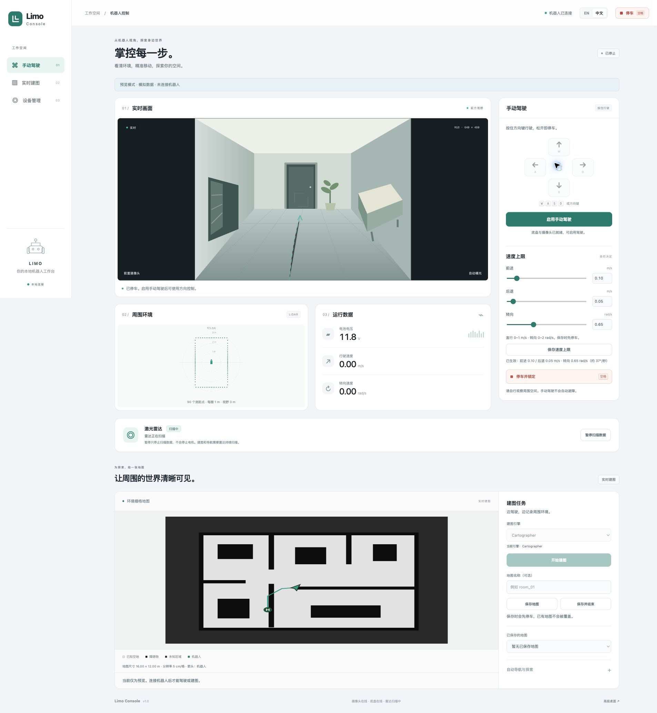

# Limo Console

**在中英文本地工作台中驾驶、建图并记录 AgileX LIMO。**

[English](README.md) · 简体中文

摄像头与雷达并排显示。自行设置前进、后退和转向上限，手动建图或使用经过路径检查的 Nav2 导航，把同步数据保存在电脑上。无需云服务、CDN 或前端构建工具。



## 录制由用户决定

- **开始录制**：开启一次记录会话。连接控制台、刷新浏览器都不会自动开始。
- **下一段 / N**：分割路线或任务，不停车、不重启传感器。
- **结束录制**：关闭本次会话并完成归档，同时停止并锁定驾驶。
- **停车 / 空格**：只停车。手动停车、避障停车、寻路等待期间都继续录制。
- 录制异常会锁定驾驶并标记异常；可用的数据流继续记录，不会被误标为用户正常结束。启用驾驶需要录制链路就绪。

图像和视频只保存在电脑上。机器人使用有容量上限的图像内存缓冲和非图像 MCAP 暂存。电脑核对文件大小与 SHA-256，持久化文件和校验凭据后，才通知机器人删除对应分段。

## 功能

- 按住行驶的键盘／触摸控制。前进、后退分别设置 **0–1 m/s**；转向设置 **0–2 rad/s**。保存限速时先停车。
- 摄像头保持原始宽高比，与雷达、运行状态同屏。全界面可切换英文／简体中文。
- 默认 **640 × 480、10 fps、H.264 MP4**；可选摄像头支持的原生分辨率、**FFV1 MKV** 或 **PNG 序列**无损 RGB 存储。吞吐不足时锁定驾驶；设备列出的规格不代表每种组合都能持续运行。
- MCAP 记录原始非图像 ROS 话题、里程计、IMU、请求与实际输出指令、底盘状态、配置及操作事件。提供离线 CSV 导出和保留原件的恢复工具。
- 手动 SLAM、地图导出、SLAM 状态保存，以及输入实际初始位姿后的地图定位。自动探索先检查路径，无法确认进展时停车。
- 提供观测、有限操作、结果验证和离线回放组成的 robot harness。默认禁止 harness 发出移动指令，不依赖语言模型或云端凭据。
- 雷达持续扫描，已移除暂停／恢复和电机停转控制。

## 快速开始

需要已能正常运行的 ROS 2 Humble 机器人环境。首次安装先阅读[安装说明](docs/installation.zh-CN.md)。

```sh
git clone https://github.com/EZeJ/limo-console.git
cd limo-console
# 机器人上，在 ROS 环境或容器内：
sudo bash scripts/install.sh
bash /control/manage.sh start
# 电脑上，需要 Python 3.10+：
./scripts/connect.sh USER@ROBOT_HOST
```

打开 **http://127.0.0.1:18765/**。点击“开始录制”，等待就绪，再主动启用驾驶。SSH 使用你自己的凭据，脚本不保存密码。数据默认保存在 `~/Documents/Limo Console/recordings/`；使用 `--data-dir PATH` 可更换目录。

没有机器人也可以查看只读模拟界面：

```sh
python3 -m venv .venv
. .venv/bin/activate
python -m pip install -r requirements-dev.txt
python scripts/preview.py
```

打开 **http://127.0.0.1:18766/**。摄像头场景和地图均为合成素材，不连接机器人，也不会驱动车辆。

## 文档

| 内容 | English | 简体中文 |
| --- | --- | --- |
| 安装、部署、驱动补丁、回滚 | [Installation](docs/installation.md) | [安装与部署](docs/installation.zh-CN.md) |
| 驾驶、录制、建图、恢复 | [User guide](docs/usage.md) | [使用指南](docs/usage.zh-CN.md) |
| 数据格式、API、控制机制 | [Architecture](docs/architecture.md) | [架构与 API](docs/architecture.zh-CN.md) |
| Harness 与验收标准 | [Harness](docs/harness.md) | [Harness 与验收](docs/harness.zh-CN.md) |
| 参与开发 | [Development](CONTRIBUTING.md) | [开发说明](CONTRIBUTING.zh-CN.md) |

## 仓库与验证范围

`robot/` 包含车端服务、网页和 ROS 配置；`robot/integration/` 包含驱动补丁与校验；`companion/` 负责电脑录像和归档；`harness/` 提供能力接口、静止诊断、离线导出与恢复；`scripts/` 提供连接和部署命令。

目标环境是 Ubuntu 22.04 / ARM64 Jetson 上的 ROS 2 Humble，厂商 LIMO 工作空间单独安装。本项目独立维护，不是 AgileX 官方产品。公开仓库只包含控制台代码和集成材料，不包含私人录像、住宅地图、凭据、固件或完整厂商工作空间。

服务只监听本机回环地址，通过 SSH 访问。手动驾驶的净空由操作者判断，底盘驱动必须有独立看门狗。软件测试和地图刷新不能证明行驶精度；[验收标准](docs/harness.zh-CN.md)区分静止检查与需要充足电量、合适场地的路线和探索测试。

## 许可证

控制台原创代码采用 [GNU GPL v3.0（GPL-3.0-only）](LICENSE)。上游配置和驱动补丁上下文保留[第三方声明](THIRD_PARTY_NOTICES.md)中的许可证。
